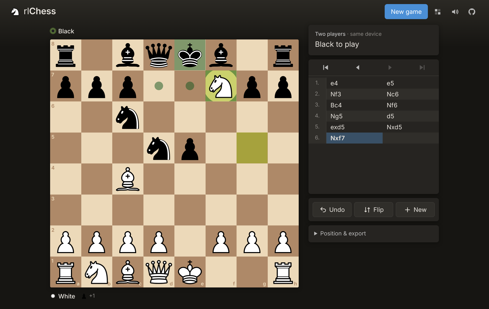

# rlChess

A chess rules engine in C#, plus a website to play on, built so you can plug in your own
computer players (minimax, and later a reinforcement-learning player trained by self-play).

**Play it:** https://jacobgoodchild.github.io/rlChess/



## What's in here

| Folder | What it is |
| --- | --- |
| `src/RlChess.Engine` | The rules library: board, legal moves, check/mate/draws, FEN, SAN/UCI, PGN (read and write). No UI code. |
| `src/RlChess.Web` | The website (Blazor WebAssembly), running the same engine in the browser. |
| `src/RlChess.Arena` | Console app that plays many games between two players and prints statistics. |
| `tests/RlChess.Engine.Tests` | Unit tests and perft tests (move-generation proofs). |

## Build, run, test

You need the [.NET 10 SDK](https://dotnet.microsoft.com/download). Open `RlChess.sln` in Rider, or:

```bash
dotnet build
```

```bash
dotnet test --filter "Category!=Slow"
```

```bash
dotnet test --filter "Category=Slow"
```

```bash
dotnet run --project src/RlChess.Web
```

```bash
dotnet run --project src/RlChess.Arena -c Release -- --games 1000 --p1 random --p2 random --pgn games.pgn --threads all
```

Speed/correctness check of the move generator: `dotnet run --project src/RlChess.Arena -c Release -- perft 5`
(optionally followed by a FEN).

Arena options: `--games`, `--p1`, `--p2`, `--pgn <file>`, `--fen <start position>`, `--max-plies`,
`--seed` (reproducible random players) and `--threads` (a number, or `all` for every CPU core).

The fast tests take about a second. The slow ones are deep perft runs (~600 million positions, about
10 seconds). Every push to `main` builds, runs the fast tests and deploys the website.

## How to add your own player

1. Write a class that implements `IPlayer` (in `src/RlChess.Engine/Players`, or a new project):

   ```csharp
   using RlChess.Engine;
   using RlChess.Engine.Players;

   public sealed class MyPlayer : IPlayer
   {
       public string Name => "My player";

       public Move ChooseMove(Position position)
       {
           // `position` is your own copy: MakeMove/UndoMove on it freely while you search.
           var moves = position.GetLegalMoves();
           Move best = moves[0];
           // ... your evaluation and search go here ...
           return best;
       }
   }
   ```

2. Register it with one line in `src/RlChess.Engine/Players/PlayerRegistry.cs`:

   ```csharp
   new("mine", "My player", "What it does, in a few words.", () => new MyPlayer()),
   ```

That's it: it now appears in the website's **New game** dialog and in the Arena
(`--p1 mine --p2 random`).

Handy engine calls: `position.GetLegalMoves()`, `MakeMove`/`UndoMove`, `IsInCheck`, `GetResult()`,
`position[square]` (the piece on a square; squares are 0–63 with a1 = 0, h8 = 63), `Hash`
(a 64-bit fingerprint, good for transposition tables), and the allocation-free
`GenerateLegalMoves(Span<Move>)` for fast search.

**Slow players on the website:** the browser runs everything on one thread, so a player that thinks
for several seconds freezes the page. If yours is slow, implement `IAsyncPlayer` instead and put
`await Task.Yield();` in your search loop now and then; the page stays responsive.

## Using the website

Drag pieces or click a piece then its target square. Right-click (or right-drag) draws circles and
arrows (hold Shift for red, Alt/Ctrl for blue). Keyboard: ← → step through moves, ↑ ↓ jump to the
start/end, `f` flips the board, Esc cancels. The square icon at the top switches board colours.

## Rules notes

- Draws by threefold repetition and the fifty-move rule are applied automatically (no claiming).
- Insufficient material: K v K, K + one minor piece v K, and positions where all remaining
  minor pieces are bishops on the same colour. (K+N v K+N is not counted: a mate is possible.)

## Credits & licences

- Code: [MIT](LICENSE).
- Chess pieces: by [Colin M.L. Burnett](https://commons.wikimedia.org/wiki/User:Cburnett), from
  Wikimedia Commons, used under the BSD licence (one of the licences the author offers). See
  [`src/RlChess.Web/wwwroot/pieces/LICENSE.md`](src/RlChess.Web/wwwroot/pieces/LICENSE.md).
- Sounds: made from scratch for this project by `tools/make-sounds.sh` (synthesised with ffmpeg),
  so they're covered by the MIT licence too.
- Perft reference numbers: [Chess Programming Wiki](https://www.chessprogramming.org/Perft_Results).
